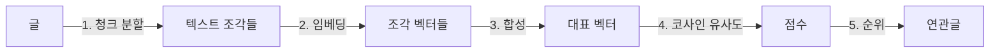

# related-posts

related-posts는 글마다 의미가 가까운 글(연관 글)을 고르는 스크립트입니다.

핵심 아이디어는 **"글을 벡터(숫자 배열)로 바꾼 뒤, 벡터끼리 방향이 얼마나 비슷한지 재서 가까운 글을 고른다."** 입니다.



## 임베딩

임베딩(embedding)은 텍스트를 고정된 길이의 숫자 배열로 바꾸는 것입니다. 이 스크립트가 쓰는 모델(`nvidia/nemotron-3.5-embed-1b`)은 텍스트 하나를 숫자 2,048개로 바꿉니다.

숫자 하나하나가 무엇을 뜻하는지는 사람이 해석할 수 없습니다. 다만 모델은 학습 과정에서 **의미가 비슷한 텍스트일수록 비슷한 방향을 가리키도록** 벡터를 배치합니다. 그래서 두 글이 얼마나 비슷한지라는 질문을, 두 벡터가 얼마나 같은 방향인지라는 기하학 문제로 바꿀 수 있습니다.

키워드 매칭과 다른 점은 단어가 겹치지 않아도 의미가 가까우면 가깝게 나온다는 것입니다. 예를 들어 "React Suspense"와 "lazy initialization"은 단어가 거의 겹치지 않지만 가까운 벡터가 됩니다.

## 1. 청크 분할

### 나누는 이유

긴 글 전체를 벡터 하나로 만들면 여러 주제가 평균내지면서 방향이 흐려집니다. 예를 들어 three.js 조명 이야기와 성능 최적화 이야기가 반씩 섞인 글은, 그 어느 쪽과도 애매하게 가까운 벡터가 됩니다.

반대로 짧은 조각은 주제가 하나라서 벡터의 방향이 선명합니다. 그래서 글을 조각(청크)으로 나눠 각각 임베딩한 다음, 나중에 합칩니다.

### 나누는 규칙

1. **코드 블록을 지웁니다.** `import`, `const`, `return` 같은 토큰은 거의 모든 기술 글에 나옵니다. 그대로 두면 서로 관련 없는 글도 "코드가 많다"는 이유로 가까워집니다.
2. **헤딩(`#`)을 기준으로 섹션을 나눕니다.** 저자가 직접 정한 주제 경계라서, 의미 단위로 자르기에 가장 믿을 만한 기준입니다.
3. **마크다운 문법을 걷어냅니다.** 이미지와 JSX 태그는 지우고, 링크와 인라인 코드는 텍스트만 남깁니다.
4. **500자를 넘는 섹션은 문단 단위로 다시 나눕니다.** 한 문단이 500자를 넘으면 500자씩 자릅니다.
5. **청크마다 `글 제목 / 섹션 제목`을 앞에 붙입니다.** 조각만 떼어 놓으면 "이 기능을 쓰면 된다" 같은 문장은 무엇에 대한 이야기인지 알 수 없습니다. 제목을 붙여서 맥락을 되살립니다.

```
Git cherry-pick 알아보기 / 사용법
모든 커밋은 고유한 식별자인 해시(hash) 값을 가진다. ...
```

본문 청크와 별도로, `제목 + 설명 + 태그`를 묶은 **메타 텍스트**도 하나 만듭니다. 글의 핵심 주제를 가장 압축해서 담고 있는 텍스트입니다.

## 2. 임베딩

메타 텍스트와 본문 청크를 모두 임베딩 API에 보내서, 각각 벡터 하나씩을 받습니다.

이때 `input_type: "passage"`로 요청합니다. 이 모델은 검색 질의(`query`)와 검색 대상 문서(`passage`)를 조금 다르게 임베딩합니다. 여기서는 문서와 문서를 비교하므로 양쪽 모두 `passage`로 맞춰야 같은 기준에서 비교할 수 있습니다.

## 3. 대표 벡터로 합성

글 하나에서 벡터가 여러 개(메타 1개 + 청크 N개) 나오므로, 이를 하나로 합칩니다.

```
본문 벡터 = normalize( Σ (청크 벡터 × 청크 글자 수) )
대표 벡터 = normalize( 본문 벡터 × 0.75 + 메타 벡터 × 0.25 )
```

### 정규화(normalize)

벡터를 그 길이로 나눠서 길이를 1로 맞추는 것입니다.

```
v = [3, 4]  →  길이 √(3² + 4²) = 5  →  normalize(v) = [0.6, 0.8]
```

정규화시켜 크기 정보를 없애고 **방향만** 남게합니다. 의미는 방향에 담겨 있으므로 정보 손실이 없습니다.

### 평균 대신 합(Σ)을 쓰는 이유

가중 평균은 원래 가중치 총합으로 나눠야 합니다. 하지만 바로 뒤의 `normalize`가 크기를 버리기 때문에 나누기는 결과에 영향이 없습니다. 그래서 합만 구합니다.

벡터를 더하면 같은 방향을 가리키는 청크끼리는 힘을 보태고, 혼자 다른 방향인 청크는 묻힙니다. 그래서 합의 방향이 글 전체가 대체로 향하는 방향이 됩니다. 여기에 글자 수를 곱해서, 한 줄짜리 "마치며" 섹션이 핵심 섹션과 같은 힘을 갖지 않게 합니다.

### 0.75와 0.25를 곱하는 이유

본문 벡터와 메타 벡터를 3:1로 섞는다는 뜻입니다. 마지막에 다시 정규화하므로 의미가 있는 건 비율뿐입니다. 비율이 그대로 영향력이 되도록, 섞기 전에 두 벡터를 각각 정규화해서 길이를 1로 맞춥니다.

메타를 섞는 이유는 이렇습니다. 본문만 쓰면 곁가지 설명이 긴 글이 핵심 주제와 다른 방향으로 끌려갑니다. 반대로 메타 비중이 너무 크면 결과가 태그 매칭과 비슷해집니다. 25%는 본문의 성격을 유지하면서 핵심 주제 쪽으로 살짝 당기는 정도로 잡은 **경험적인 시작값**입니다. 두 벡터가 서로 수직이라면 결과는 본문 쪽에서 약 18° 기울어집니다.

## 4. 코사인 유사도

두 벡터 사이 각도의 코사인 값입니다. 방향이 같으면 1, 수직이면 0, 정반대면 -1이 나옵니다.

```
cos(A, B) = (A · B) / (|A| × |B|)
```

- `A · B`(내적): 같은 위치의 숫자끼리 곱해서 모두 더한 값입니다.
- `|A|`: 벡터의 길이입니다.

3단계에서 모든 대표 벡터를 정규화했으므로 `|A| = |B| = 1`입니다. 그래서 공식이 **내적 하나로** 줄어듭니다.

```
cos(A, B) = A · B = a₁b₁ + a₂b₂ + ... + a₂₀₄₈b₂₀₄₈
```

숫자 3개짜리 벡터로 예를 들면 이렇습니다.

```
A  threejs-about-light   [0.9, 0.1, 0.2]
B  threejs-geometry      [0.8, 0.2, 0.1]
C  cookies-httponly      [0.1, 0.9, 0.3]

A · B = 0.72 + 0.02 + 0.02 = 0.76   →  정규화 후 ≈ 0.99  (거의 같은 방향)
A · C = 0.09 + 0.09 + 0.06 = 0.24   →  정규화 후 ≈ 0.27  (거의 다른 방향)
```

거리(유클리드 거리)가 아니라 각도로 비교하는 이유는 이렇습니다. 임베딩에서 의미는 방향에 담기고, 벡터의 크기는 텍스트 길이 같은 의미와 무관한 요인에 흔들리기 때문입니다.

## 5. 순위 매기기

글마다 같은 언어(locale)의 다른 모든 글과 점수를 계산합니다.

```
점수 = 코사인 유사도 + 태그 자카드 × 0.05
```

### 태그 자카드(Jaccard)

두 집합이 얼마나 겹치는지를 0~1로 나타낸 값입니다.

```
J(A, B) = |A ∩ B| / |A ∪ B|

A = [React, 성능]       B = [React, 상태관리]
→ 교집합 1개 / 합집합 3개 = 0.33
```

가중치를 0.05로 작게 둔 이유가 있습니다. 태그는 사람이 붙인 명시적인 신호지만 개수가 적고 거칠어서, 주 점수로 쓰기엔 부족합니다. 그래서 **의미 점수가 비슷할 때 순서를 가르는 보조 점수** 정도로만 씁니다. 태그가 완전히 같아도 더해지는 점수는 최대 0.05입니다.

### 고르는 규칙

1. 자기 자신과 다른 언어의 글은 제외합니다.
2. 점수가 기준값(0.3) 미만인 글은 버립니다.
3. 남은 글을 점수 순으로 정렬해서 최대 3개를 고릅니다.

기준값 미만을 버리기 때문에, 연관글이 3개보다 적거나 아예 없는 글도 생깁니다. 비슷한 글이 없는데 억지로 3개를 채우면 오히려 추천의 신뢰도가 떨어지기 때문에 의도한 동작입니다.

### 기준값을 정하는 원리

임베딩 공간에서는 서로 전혀 관련 없는 글끼리도 유사도가 0이 되지 않습니다. 같은 언어, 같은 문체, 비슷한 분야(개발 블로그)라는 공통점만으로도 어느 정도 같은 방향을 가리키기 때문입니다.

그래서 "0.5 이상이면 연관" 같은 절대 기준은 쓸 수 없고, **전체 글 쌍의 유사도 분포를 기준으로** 정해야 합니다.

```
글 쌍 코사인 유사도 분포 (1176쌍): min 0.103 / p50 0.248 / p90 0.347 / max 0.755
```

- `p50`(중간값) 0.25 근처는 "보통 관련 없는 글끼리"가 받는 점수입니다. 이 블로그 공간의 바닥값입니다.
- `p90`(상위 10%) 0.35 근처부터가 우연이라고 보기 어려운 연관성이 생기는 구간입니다.
- 기준값을 바닥값보다 충분히 높게, 상위 구간 근처에 두어야 무관한 추천이 걸러집니다.

글 49개면 쌍은 49 × 48 / 2 = 1,176개입니다. 쌍마다 숫자 2,048개짜리 내적 한 번이라서, 전체 계산은 순식간에 끝납니다.

## 증분 계산

API 비용이 드는 단계는 2단계 임베딩뿐입니다. 1단계는 텍스트 처리, 3~5단계는 순수한 수학 계산입니다.

그래서 글마다 **대표 벡터를 저장해 두고 재사용**합니다. 새 글이 하나 추가되면 그 글만 임베딩하고, 순위(4~5단계)는 저장된 벡터로 전체를 다시 계산합니다. 새 글이 기존 글의 연관글 목록에 들어갈 수 있으므로 순위는 항상 전체를 다시 계산해야 하지만, 계산 비용은 거의 없습니다.

저장된 벡터가 여전히 유효한지는 해시로 판단합니다. 벡터에 영향을 주는 값을 모두 넣어 SHA-256 해시를 만들고, 저장해 둔 해시와 다르면 "내용이 바뀐 글"로 봅니다.

- 모델 이름, 청크 크기(500), 메타 비중(0.25)
- 제목, 설명, 태그
- 본문

모델이 바뀌면 저장된 벡터는 모두 쓸 수 없게 됩니다. 모델마다 벡터 공간이 달라서, 다른 모델로 만든 벡터끼리는 방향을 비교하는 것 자체가 의미가 없기 때문입니다.
